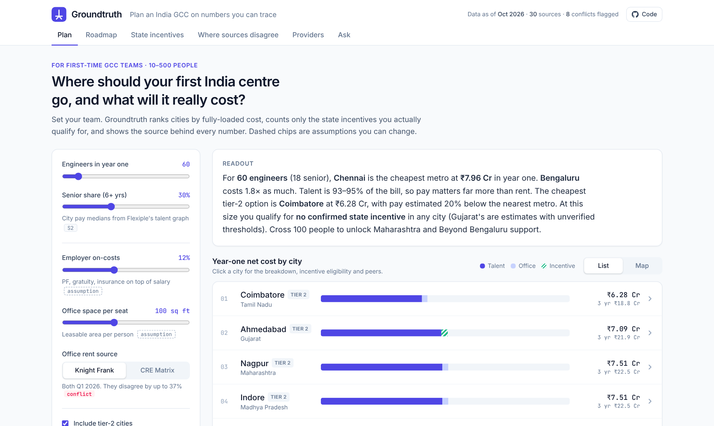
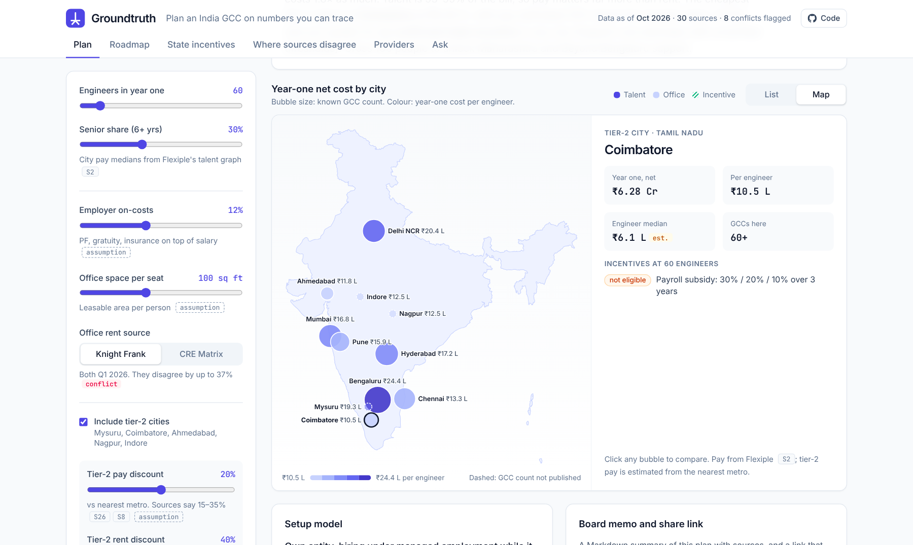
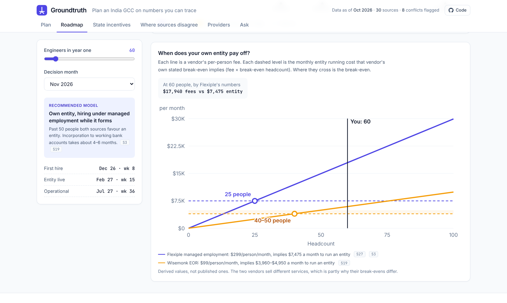
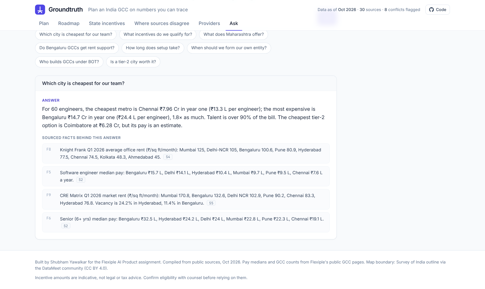
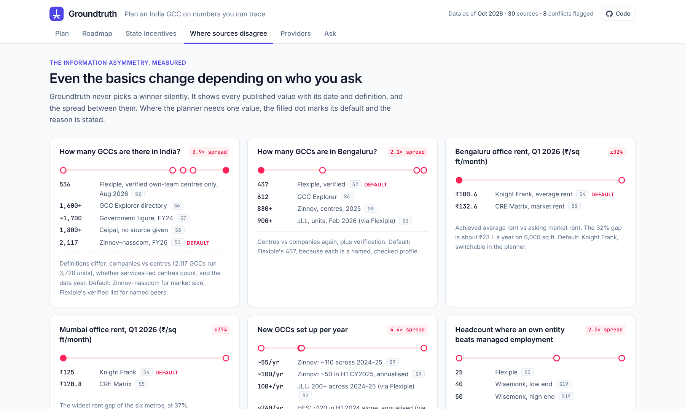

# Groundtruth: India GCC planner

Plan a first Global Capability Centre (GCC) in India on numbers you can trace.

Groundtruth ranks Indian cities by the fully-loaded cost of your team. It counts only the state incentives you actually qualify for and lays out a week-by-week setup roadmap. Where public sources disagree, it shows every value, and every number links to the public source it came from.

**Live demo:** _add your Vercel URL here_ · Built for the Flexiple AI Product assignment, October 2026.



## Why this exists

India has more than 2,000 GCCs, but even the basics depend on who you ask:

- GCC counts range from 536 to 2,117.
- Office rents for the same city and quarter differ by up to 37%.
- Most headline state incentives exclude the metros where GCCs actually go.

First-time, mid-market companies make a decision that locks in cost for years. Most do it on referrals, without an India team or a Big 4 budget. Groundtruth is a planner built for that buyer.

## Features

| Tab | What it does |
|---|---|
| **Plan** | Six metros and five tier-2 cities ranked by 3-year net cost or talent depth. Editable assumptions, a rent-source switch that exposes a live source conflict, a list or India map view, a Markdown board memo and a shareable scenario link. |
| **Roadmap** | Week-by-week Gantt plan that stretches with team size and setup model, plus a break-even chart showing when an own entity beats managed employment, derived from each vendor's own numbers. |
| **State incentives** | Eligibility at your headcount across 11 cities, and nine state policies with status (notified, partial, unverified, draft) and the catch in each. |
| **Where sources disagree** | Eight contested numbers plotted with their spread, the planner's default and why, plus a register of 30 sources, with commercial interests flagged. |
| **Providers** | Track records graded A–D by evidence strength: client-verified, press-reported deal, secondary list, or self-reported. |
| **Ask** | Plain-English questions answered from your plan first, then backed by the sourced facts. It answers "no sourced data" rather than guessing. Optional LLM answers via an API route. |

| Map | Roadmap and break-even |
|---|---|
|  |  |
| **Ask** | **Where sources disagree** |
|  |  |

## How the numbers work

- **Talent:** engineers × the city's median pay, split by senior share, plus employer on-costs (an assumption, default 12%). Pay medians come from Flexiple's public talent graph. No source publishes tier-2 pay by role, so tier-2 pay is the nearest metro's median minus an editable discount (default 20%; sources say 15–35%).
- **Office:** seats × sq ft per seat × rent × 12. Metro rents come from Knight Frank or CRE Matrix (Q1 2026, switchable). Tier-2 rent is the nearest metro's rent minus an editable discount, except Ahmedabad, which has a published figure.
- **Incentives** are coded as rules (`lib/calc.ts`), so eligibility follows your headcount, salary thresholds, zones and parent-company status. Unverified or draft policies count as ₹0. Gujarat's figures are labelled estimates because its eligibility thresholds weren't in the sources checked.
- **Setup model and break-even:** each vendor's per-person fee × its own stated break-even headcount gives the monthly entity running cost it implies.
- **Ask** (`lib/ask.ts`) detects the intent and the cities or states in a question. It computes the answer from your current plan, then retrieves the supporting facts. If `ANTHROPIC_API_KEY` or `OPENAI_API_KEY` is set, `/api/ask` has the model rewrite the answer using only those facts.

Assumptions are shown as dashed chips in the UI. Incentive amounts are indicative, not legal or tax advice.

## Tech stack

Next.js 15 (App Router) · React 19 · TypeScript · Tailwind CSS v4 · Vitest · GitHub Actions · Vercel. The fonts (Inter, JetBrains Mono) are self-hosted via Fontsource. The India map is a projected SVG generated at build time with d3-geo; there is no map library at runtime.

```
app/
  page.tsx              → renders the client app
  api/ask/route.ts      → optional LLM answers (Anthropic or OpenAI)
components/             → one panel per tab, plus shared UI (chips, sliders, cards)
lib/
  calc.ts               → cost model, incentive rules, setup-model advice
  roadmap.ts            → week-by-week plan
  ask.ts                → intent detection, computed answers, fact retrieval
  memo.ts               → Markdown board memo
  data/                 → cities, states, sources, conflicts, providers, facts, map
  __tests__/            → unit tests for the model, Ask and roadmap
scripts/build-map.mjs   → regenerates lib/data/india-map.ts from the boundary file
```

## Run locally

```bash
npm install
npm run dev        # http://localhost:3000
npm test           # unit tests
npm run lint && npm run typecheck
npm run build
```

Requires Node 20 or newer.

## Deploy on Vercel

1. Push this repo to GitHub.
2. In Vercel, choose **Add New → Project**, import the repo and keep the defaults (framework: Next.js).
3. Optional: add `ANTHROPIC_API_KEY` or `OPENAI_API_KEY` under **Settings → Environment Variables** to turn on AI answers in Ask. See `.env.example`.
4. Put your repo URL in `lib/site.ts` so the Code button links to it.

## Data and limits

- All data is compiled from public sources as of October 2026. The full list is in the app's source register (`lib/data/sources.ts`).
- Pay medians are city-wide, not matched by role or level.
- Tier-2 GCC counts and talent pools are mostly unpublished, so the app shows "not published" instead of a number.

## Credits

Map boundary: Survey of India outline via the [DataMeet India community](https://github.com/datameet/maps) (CC BY 4.0).

## License

MIT © 2026 Shubham Yawalkar
